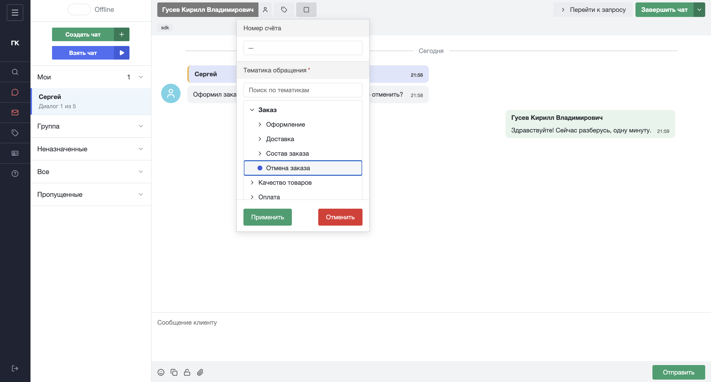
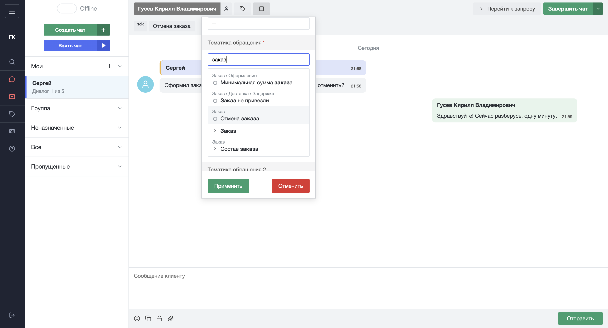
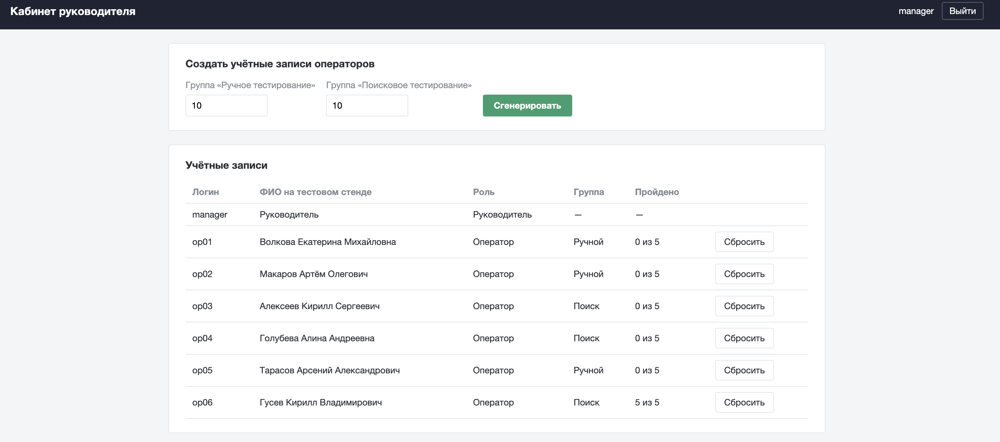
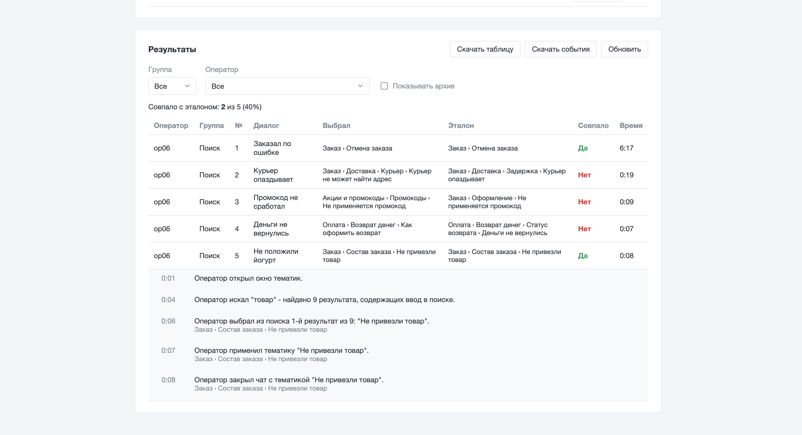
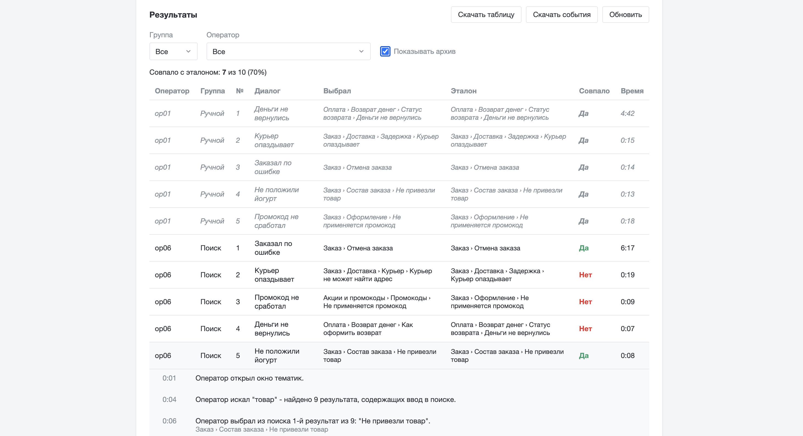

# Стенд тематик

Тестовый стенд, который имитирует окно чата в хелпдеске и проверяет, насколько удобна иерархия тематик обращений для операторов поддержки.
Оператор проходит цепочку смоделированных диалогов с клиентами. В каждом он находит подходящую тематику, раскрывая дерево разделов или через поиск и завершает чат. Стенд записывает каждое действие: какие разделы раскрывал и сворачивал, что искал, что выбрал. Руководитель видит, совпал ли выбор с эталоном, сколько времени ушло и каким путём оператор к нему пришёл.







# Контекст

Проект сделан по рабочей задаче: требовалось протестировать удобство иерархии тематик среди операторов поддержки. Стенд спроектирован и реализован самостоятельно по задаче, поставленной мне. Настоящие тематики и диалоги заменены вымышленным примером — поддержкой сервиса быстрой доставки продуктов.

# Возможности

**Оператор**
- получает 5 диалогов в случайном порядке. У каждого свой, чтобы порядок не влиял на результат;
- выбирает тематику во всплывающем окне, как в хелпдеске: аккордеоном по дереву любой
  глубины или поиском;
- поиск понимает "е" вместо "ё", любой регистр и текст, набранный в неверной раскладке
  (`djpdhfn` = "возврат"), подсвечивает совпадение и показывает путь до каждого результата;
- без выбранной тематики чат не завершить.

**Руководитель**
- создаёт учётные записи пачкой: логины, пароли и случайные ФИО, разбивка операторов на группы;
- видит таблицу результатов: кто, какой диалог, что выбрал, эталон, совпало ли, время;
- открывает траекторию любого прохождения — все действия оператора по шагам;
- выгружает результаты и события в CSV для Excel для проведения анализа тестирования;
- сбрасывает прохождение оператора — старые результаты уходят в архив, а не удаляются. Для истории можно поставить галочку и отображать архив вместе с актуальными записями.

## Стек

- **Фронт:** React 19, Vite, React Router, TanStack Query, CSS Modules
- **Бэк:** Node 22, Fastify 5, PostgreSQL (локально PGlite) + Drizzle ORM, Zod
- **Общее:** npm workspaces, общие типы в `packages/shared`

## Структура

```
apps/
  api/                      бэкенд
    drizzle/                SQL-миграции (генерируются, коммитятся)
    src/
      auth/session.ts       сессии в БД + cookie, requireRole()
      data/load.ts          загрузка и проверка дерева и сценариев из data/
      db/schema.ts          схема БД
      lib/                  ошибки, пароли, генератор ФИО
      modules/*.routes.ts   маршруты: auth, topics, runs (оператор), manager
      scripts/              migrate, seed, check-data
  web/                      фронтенд
    src/
      api/                  fetch-обёртка и список эндпоинтов
      app/router.tsx        маршруты страниц
      features/
        auth/               вход, текущая учётка, защита по ролям
        chat/               окно оператора
        topic-picker/       выбор тематики - главный компонент стенда
        manager/            кабинет руководителя
      styles/tokens.css     цвета хелпдеска
packages/
  shared/                   типы домена и API, нормализация поиска
data/                       дерево тематик и диалоги (в git — только пример *.example.json)
docs/
  database.md               всё про базу: создание, миграции, запросы, бэкап
```

## Быстрый старт

Нужен только Node 22 — Postgres для разработки ставится вместе с проектом
через npm (PGlite), устанавливать в систему ничего не надо.

```bash
nvm use                 # Node 22
npm install
cp .env.example .env    # поменяй SESSION_SECRET и SEED_MANAGER_PASSWORD

# терминал 1 — база, не закрывать
npm run db:local

# терминал 2
npm run db:seed         # создаёт таблицы и первого руководителя
npm run dev             # API на :3000, фронт на :5173
```

Открой http://localhost:5173, войди руководителем, сгенерируй учётки, скачай CSV
с паролями, войди одной из них — откроется окно оператора.

## Команды

| Команда               | Что делает                                      |
| --------------------- | ----------------------------------------------- |
| `npm run db:local`    | Локальный Postgres без установки (PGlite)       |
| `npm run dev`         | API и фронт с перезагрузкой при изменениях      |
| `npm run typecheck`   | Проверка типов во всех пакетах                  |
| `npm run lint`        | ESLint                                          |
| `npm run format`      | Prettier                                        |
| `npm run data:check`  | Проверить дерево и сценарии без запуска сервера |
| `npm run db:generate` | Новая миграция после правки `db/schema.ts`      |
| `npm run db:migrate`  | Применить миграции                              |
| `npm run db:seed`     | Создать первого руководителя из `.env`          |
| `npm run build`       | Собрать фронт и API для продакшена              |
| `npm start`           | Запустить собранное (API отдаёт и фронт)        |

Миграции применяются автоматически при старте сервера.

## Развёртывание

```bash
cp .env.example .env    # заполнить; COOKIE_SECURE=true только если стенд по HTTPS
docker compose up -d --build
docker compose exec stand node apps/api/dist/seed.js
```

Поднимутся два контейнера: Postgres и стенд. Если у компании уже есть свой
Postgres — убери сервис `db` и укажи его адрес в `DATABASE_URL`.
Дерево и сценарии лежат на сервере в `./data`. Бэкап базы — `docs/database.md`.
